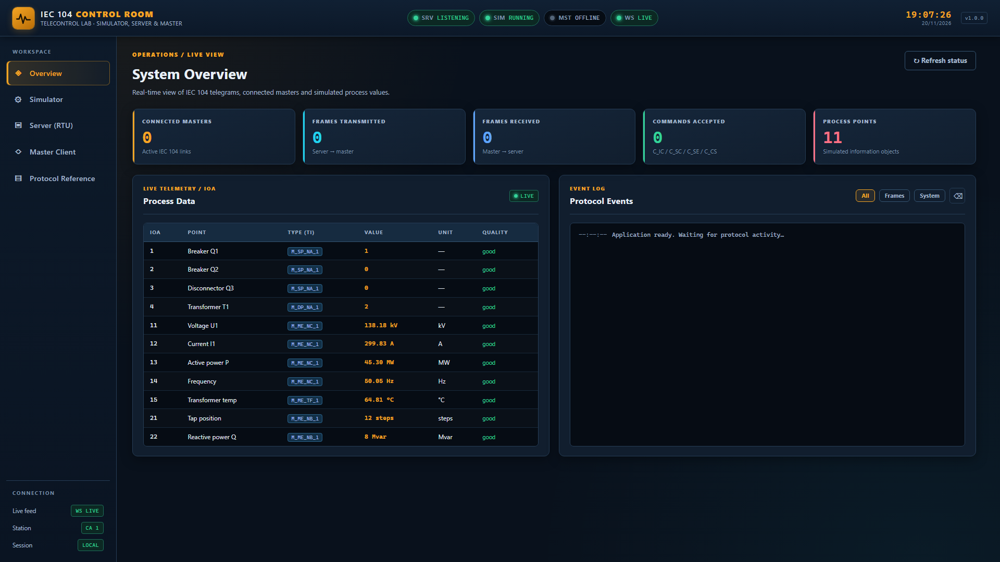
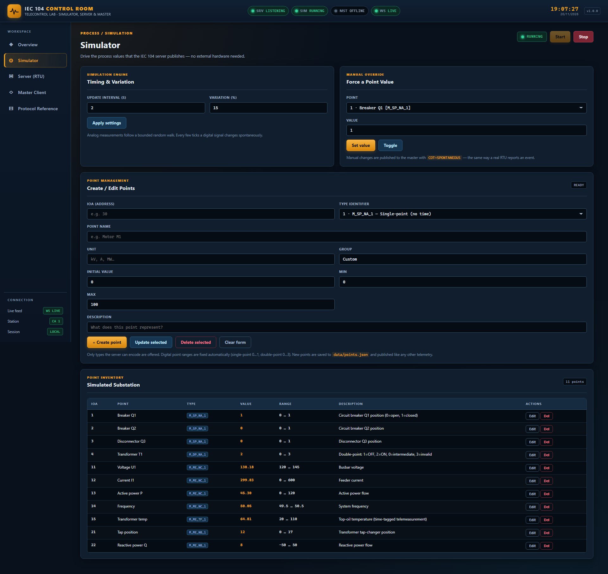
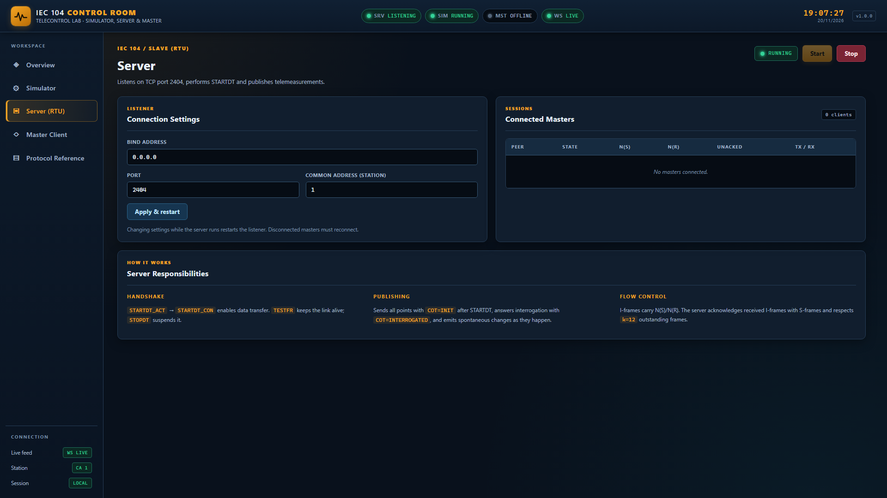
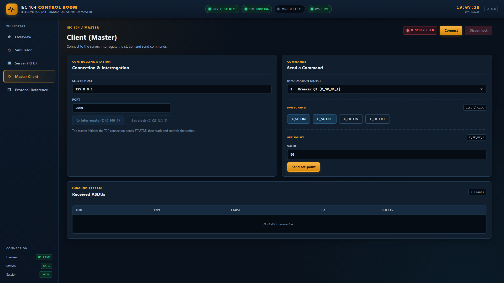
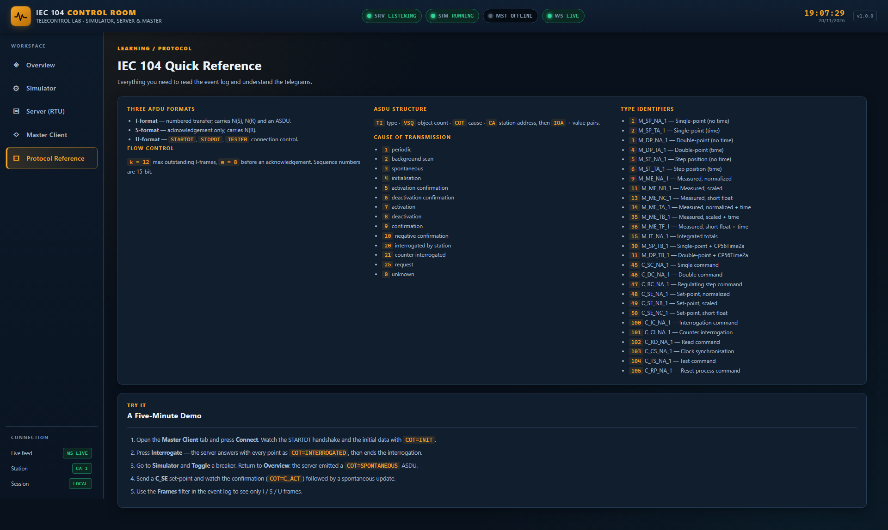

# ⚡ IEC 60870-5-104 Control Room

A complete IEC 104 learning app written in **pure Python** — nothing else to install or buy. 🧪

One web page contains everything: a **simulator**, a **server** (the station / RTU side)
and a **client** (the master / control-centre side), shown in the same dark industrial
UI as the MQTT Control Room project (status pills, sidebar tabs, live tables and a
message log). You need no PLC, no RTU, no separate simulator and no IEC 104 library —
the whole protocol is written from scratch in this repository, so you can watch, log
and understand every single message. 📡

> 🎬 Use it to learn IEC 104, to record YouTube walkthroughs, and as a clean base
> that can be connected to real hardware later.

> 📘 **Newbie-friendly PDF guide:** [`docs/IEC104-Beginner-Guide.pdf`](docs/IEC104-Beginner-Guide.pdf)
> explains the protocol with simple diagrams, tables and screenshots — the same
> explanation given in this README, but illustrated. Regenerate it any time with
> `python docs/generate_guide.py`.

---

## 🚀 1. Quick start

```powershell
cd Projects\Python\IEC-104
pip install -r requirements.txt
python run.py
```

Then open **http://127.0.0.1:8000** in your browser. 🌐

Want a different port? Keep the host local for safety:

```powershell
$env:HOST="127.0.0.1"; $env:PORT="8010"; python run.py
```

When the app starts, it automatically:

* 🖥️ starts the IEC 104 **server** on TCP port **2404** (your computer only — station/CA = 1);
* ⚙️ starts the **simulator**, which updates the values every 2 seconds;
* 🔌 leaves the **client** disconnected until you press *Connect*.

On Windows you can also just double-click **`run.bat`** — it asks for the port number to run on (any port from 1 to 65535). 🪟

---

## 📸 2. Screenshots

One capture per tab of the app. 🖼️

### 📊 Overview



### ⚙️ Simulator



### 🖥️ Server (RTU)



### 🔌 Client (Master)



### 📘 Protocol Reference



---

## 📚 3. IEC 104 in 60 seconds

IEC 60870-5-104 is the TCP/IP version of the IEC 60870-5-101 telecontrol protocol.
Electric utilities and SCADA systems use it to send measurements and commands between
a control centre (**master**) and a remote station (**slave / RTU**). 🏭

Three ideas are all you need to follow the message log in this app:

1. 📦 **APDU** — the TCP message itself. It comes in three formats:
   * `I` (information): carries sequence numbers **and** data (an ASDU).
   * `S` (supervisory): just an acknowledgement — "I received everything up to N(R)".
   * `U` (unnumbered): connection control — `STARTDT`, `STOPDT`, `TESTFR`.
2. 📨 **ASDU** — the data inside the message. The header says `TI` (what kind of data),
   `VSQ` (how many objects), `COT` (why it was sent) and `CA` (station address).
   The body holds one or more `IOA` (point address) + value pairs.
3. 🎯 **COT (Cause of Transmission)** — *why* the message was sent. The common values:
   `1` periodic, `3` spontaneous, `4` initialisation, `5` request, `6` activation,
   `7` activation confirmation, `8` deactivation, `9` deactivation confirmation,
   `10` activation termination, `20` response to interrogation.

Flow control: at most **k = 12** I-frames may be unacknowledged at once, and the peer
acknowledges after **w = 8** received frames. Sequence numbers are 15-bit (0…32767). 🔄

The **Quick reference** tab in the app lists the common type identifiers and causes. 📖

---

## 🎬 4. A 5-minute demo (great for videos)

1. 👀 Open the page. Point out the three status badges: **Server**, **Simulator**,
   **Master**.
2. 📋 In **Live Process Data**, show the 11 demo points (breakers, voltages, power,
   frequency, transformer temperature, tap position…).
3. 🔌 Press **Connect** in the Master Client tab. The log shows the handshake:
   `TX U STARTDT_ACT` → `RX U STARTDT_ACT` → `TX U STARTDT_CON`, and the server
   immediately sends **all points with COT = INIT**.
4. 🔎 Press **Interrogate (C_IC_NA_1)**. You will see the command (COT = ACT), its
   confirmation (COT = ACT_CON), every point as **COT = INTERROGATED**, and finally
   `C_IC_NA_1 COT = ACT_TERM` (end of interrogation).
5. 🔀 Use **Manual override → Toggle** on *Breaker Q2*. The server sends one single
   **spontaneous** ASDU (`M_SP_NA_1`, COT = SPONTANEOUS) — this is event-driven
   telemetry in action.
6. 🎛️ Pick *Active power P (IOA 13)*, type for example `80` and press **C_SE**.
   Watch the set-point go out (`C_SE_NC_1`), the server confirm it (`COT = ACT_CON`),
   and then a spontaneous update of the measured value.
7. ⚡ Press **C_SC ON/OFF** on a breaker, and **Clock sync (C_CS_NA_1)**.
8. 🧾 Use the log filters: **Frames** shows only the I/S/U frames, **System** shows
   the handshake messages.
9. ➕ In the **Simulator** tab, create your own point (e.g. IOA `30`, type `M_ME_NC_1`,
   name "Motor M1"). It appears in the live table immediately and is published by the
   server like any other point. Points survive restarts in `data/points.json`. 💾

Everything on the page is live — the WebSocket pushes every message as it happens. ⚡

---

## 🏗️ 5. Architecture

```
┌─────────────────────────── one Python process ───────────────────────────┐
│                                                                          │
│  Browser (tabbed single-page UI)                                         │
│     │  REST (/api/...)                    ▲ WebSocket (/ws)              │
│     ▼                                     │ events                       │
│  FastAPI  ──────────►  AppManager  ────────┘                             │
│                         │      │      │                                 │
│              ┌──────────┘      │      └──────────┐                       │
│              ▼                 ▼                 ▼                       │
│         Simulator        IEC104Server        IEC104Client               │
│       (process data)     (slave, :2404)      (master)                   │
│              │                 ▲                 │                       │
│              └── publish ──────┘                 │                       │
│                    C_IC / C_SC / C_SE / C_CS ────┘                       │
└──────────────────────────────────────────────────────────────────────────┘
```

One Python process runs everything: the browser talks to FastAPI over REST and a
WebSocket, and the AppManager wires the simulator, the server and the client together.

| File 📁 | What it does |
|------|---------|
| `iec104_app/protocol.py` | 🧠 The protocol brain: encodes and decodes APDU (I/S/U), ASDU, values and timestamps (CP56Time2a), plus the COT/TI tables. Pure logic, no networking — easy to study and test. |
| `iec104_app/simulator.py` | ⚙️ The fake power station: analog values drift randomly, digital points flip occasionally, and you can create, edit and delete points (saved in `data/points.json`). |
| `iec104_app/iec104_server.py` | 🖥️ The station side (slave/RTU): STARTDT/STOPDT/TESTFR handshake, k/w flow control, sends periodic/spontaneous/initial data, and answers interrogation and commands. |
| `iec104_app/iec104_client.py` | 🔌 The control-centre side (master): handshake, interrogation, commands, clock sync, keep-alive, and a buffer of received data. |
| `iec104_app/manager.py` | 🧩 Connects the three parts, runs the event bus, and gives the web layer thread-safe status. |
| `iec104_app/web/main.py` | 🌐 FastAPI routes, the WebSocket bridge and logging. |
| `iec104_app/web/templates/base.html` | 🏗️ Page shell: top bar, status pills, sidebar tabs. |
| `iec104_app/web/templates/index.html` | 📑 The five tabs (Overview, Simulator, Server, Master, Reference). |
| `iec104_app/web/static/css/style.css` | 🎨 Dark industrial theme (same look as the MQTT Control Room). |
| `iec104_app/web/static/js/app.js` | 🕹️ Browser logic: WebSocket events, REST calls, live tables. |
| `iec104_app/config.py` | ⚙️ Paths and settings, saved in `data/settings.json`. |
| `run.py` / `requirements.txt` | 🚀 Launcher and dependencies. |
| `docs/IEC104-Beginner-Guide.pdf` | 📘 Illustrated beginner's guide (generated by `docs/generate_guide.py`). |

---

## 🔌 6. REST API

| Method | Endpoint | Description |
|--------|----------|-------------|
| GET | `/api/status` | Server/client/simulator state, counters, connected masters |
| GET | `/api/points` | Current point values |
| GET | `/api/events?limit=200` | Buffered protocol/system events |
| DELETE | `/api/events` | Clear the event buffer |
| GET | `/api/client/data` | Last ASDUs received by the master |
| GET | `/api/config` | Public settings + TI/COT metadata |
| POST | `/api/server/start` · `/api/server/stop` | `{"host","port","common_address"}` |
| POST | `/api/client/connect` · `/api/client/disconnect` | `{"host","port"}` |
| POST | `/api/client/interrogate` · `/api/client/clock-sync` | Ask for all points / set the station clock |
| POST | `/api/client/command/single` | `{"ioa":1,"on":true}` (C_SC_NA_1) |
| POST | `/api/client/command/double` | `{"ioa":4,"value":2}` (C_DC_NA_1) |
| POST | `/api/client/command/setpoint` | `{"ioa":13,"value":80.5}` (C_SE_NC_1) |
| POST | `/api/simulator/start` · `/api/simulator/stop` | Simulator control |
| POST | `/api/simulator/settings` | `{"interval":2.0,"variation":15}` |
| POST | `/api/simulator/set` | `{"ioa":11,"value":135.5}` manual override |
| POST | `/api/simulator/toggle/{ioa}` | Toggle a digital point |
| POST | `/api/simulator/points` | ➕ Create a point: `{"ioa":30,"ti":13,"name":"Motor M1","unit":"A","value":10,"min":0,"max":50}` |
| PUT | `/api/simulator/points/{ioa}` | ✏️ Edit a point definition (same fields except `ioa`) |
| DELETE | `/api/simulator/points/{ioa}` | 🗑️ Delete a point |
| WS | `/ws` | Live `status`, `points`, `frame`, `log` events |

Interactive API docs: **http://127.0.0.1:8000/docs** 📄

---

## 🧪 7. What the protocol stack supports

**📦 APDU:** I / S / U formats, 15-bit sequence numbers, k/w flow-control window,
STARTDT / STOPDT / TESTFR keep-alive, and TCP stream re-assembly that resyncs after
garbage bytes. Everything is strictly validated — format, control fields, lengths and
the 253-byte size limit — and oversized point groups are split into several ASDUs
instead of failing.

**📨 ASDU:** both `sq=0` (every object carries its own address) and `sq=1` (sequential
addresses), 2-byte COT + originator, 2-byte CA, 3-byte IOA, and multi-object messages
grouped by type. Bad data is rejected: unknown type identifiers, truncated or
oversized payloads, zero object counts, and elements with the wrong length.

**🔢 Data types:**

* `M_SP_NA_1` single-point, `M_DP_NA_1` double-point
* `M_ME_NB_1` scaled, `M_ME_NC_1` short float, `M_ME_TF_1` float + CP56Time2a
* `C_SC_NA_1` single command, `C_DC_NA_1` double command, `C_SE_NC_1` set-point
* `C_IC_NA_1` interrogation (QOI=20), `C_CS_NA_1` clock synchronisation

**🎯 Causes:** periodic (1), spontaneous (3), init (4), request (5), activation
(6), activation confirmation (7), deactivation (8), deactivation confirmation (9),
activation termination (10), interrogated (20).

**🛡️ Command rules:** the select/execute flag is bit 7 in SCO (`C_SC_NA_1`) and
DCO (`C_DC_NA_1`). Valid direct-execute commands are applied and confirmed with
`PN=0`. Select-only commands, reserved qualifiers, invalid DCO states, unknown IOAs
and non-finite set-points are rejected with `PN=1` (negative confirmation).
Interrogation (QOI=20) always ends with `COT=ACT_TERM`.

---

## 🏭 8. How "industry ready" is it?

The structure follows good production practices: ✅

* the protocol code is separate from the networking and the UI;
* clean start/stop/shutdown lifecycle (safe to call more than once);
* all shared state is protected by locks, and sending/receiving run on their own
  threads — a slow browser can never block the protocol;
* acknowledgement windows are bounded and waits time out, so nothing deadlocks;
* rotating log files and a buffered event bus with back-pressure;
* settings persist in `data/settings.json`, and every API input is validated by Pydantic;
* the browser reconnects its WebSocket automatically.

**⚠️ What it deliberately does NOT do (be honest in videos and when extending):**
this is a *demonstration stack*, not a certified IEC 104 implementation. It skips
TLS/security, file transfer, counter interrogation, duplicate-ASDU suppression and
formal conformance testing. Also, IEC 104 itself has no login or encryption — anyone
who can reach port 2404 can send commands. That is why the server listens on
`127.0.0.1` (your own computer) only. To go beyond that you need a trusted network
plus a VPN, firewall or IEC 62351 gateway in front of it, and you must validate
against a certified IEC 104 tester before touching a real station. The built-in
master exists so the whole conversation fits on one page — with real hardware you
would turn it off and feed the server your RTU data.

---

## 🛠️ 9. Common problems and fixes

* 🔥 **"port 2404 already in use"** — stop the other IEC 104 software, or change the
  server port in the app and press *Apply* (the client port must match).
* 🔥 **"[WinError 10048] … 8000"** — another program is using the web port; start
  with `$env:PORT="8010"`.
* ❓ **Master connected but no data** — the server only sends data while a master is
  active; press *Interrogate* or wait for the next simulator update.
* ❓ **The log looks empty** — check the browser's WebSocket connection (it reconnects
  by itself) and look in `data/app.log`.

---

## ✅ 10. Tests and requirements

```powershell
python -m unittest discover -s tests -v
```

The tests cover APDU/ASDU round-trips, sequence-number wrap-around, TCP stream
buffering and resync, information elements and CP56Time2a timestamps. 🧪

* Python 3.10+ (tested on 3.13) 🐍
* `fastapi`, `uvicorn`, `pydantic`, `jinja2` — see `requirements.txt` 📦
* No IEC 104 library, no PLC, no separate simulator needed. 🎉
