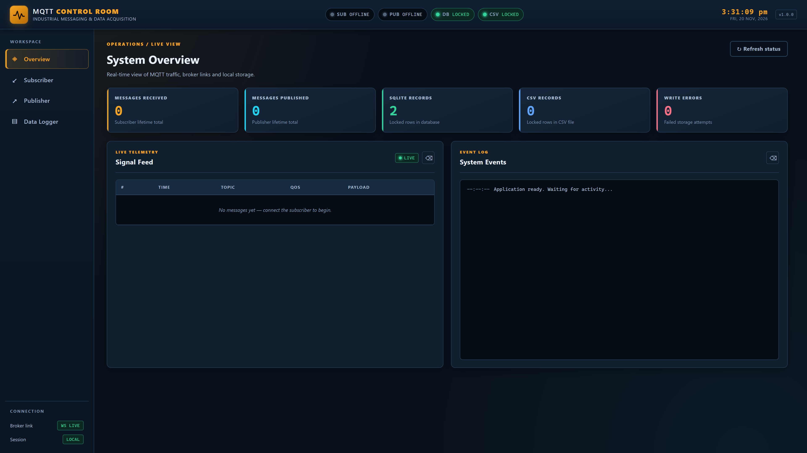
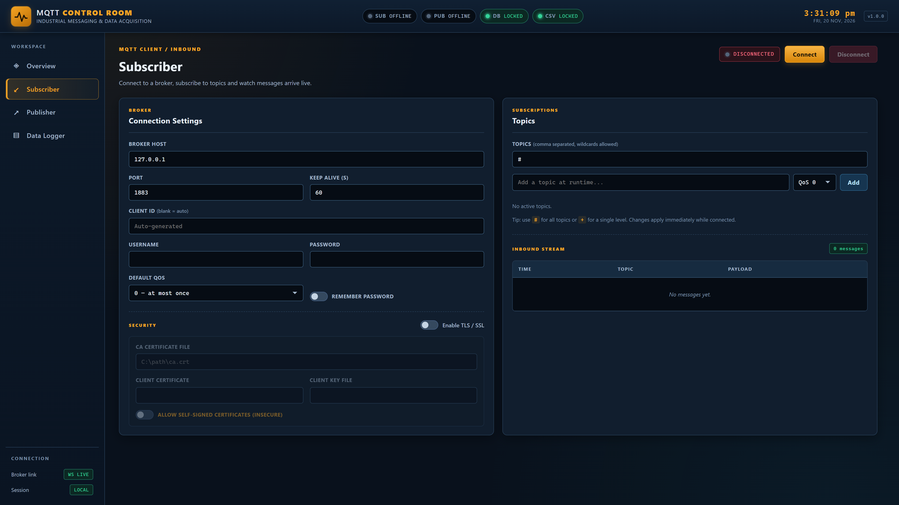
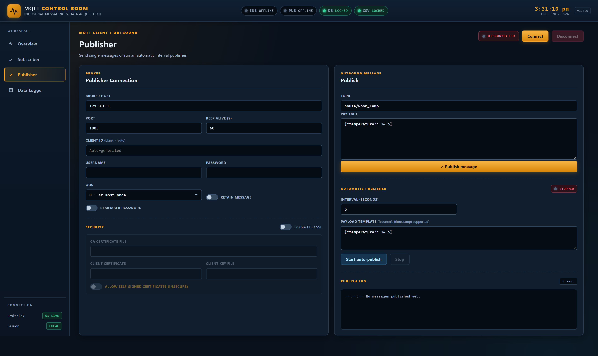
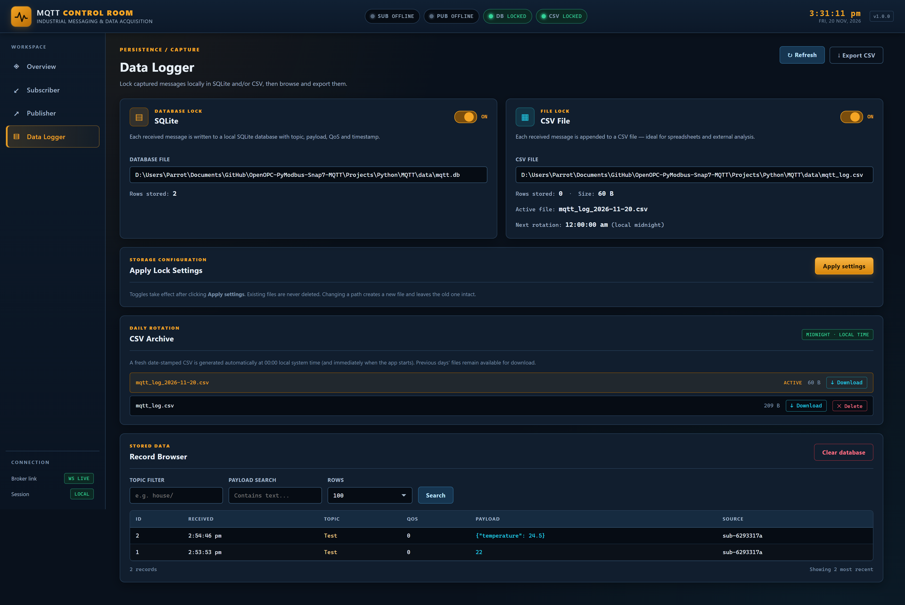

# MQTT Control Room

A single, locally hosted industrial web application that combines the three
capabilities that were previously scattered across separate scripts and
notebooks in this folder:

| Capability | What it does |
|---|---|
| **MQTT Subscriber** | Connects to any MQTT broker, subscribes to one or more topics (wildcards supported), and displays messages live over a WebSocket. |
| **MQTT Publisher** | Publishes single messages and runs an optional automatic interval publisher. |
| **MQTT Data Logger** | "Locks" every received message into a local **SQLite** database and/or a **CSV** file, with a browser for filtering and exporting the stored data. CSV files rotate automatically at local midnight. |

The original files were **moved to `[OLD]/`** (nothing was deleted) and were
used as the reference for broker settings, topics and the SQLite schema.

---

## Quick start

```powershell
cd Projects\Python\MQTT
pip install -r requirements.txt     # skip if already installed
python run.py                       # or double-click run.bat (it asks for a port: 1-65535)
```

Then open **http://127.0.0.1:8000** in a browser.

The server binds to `127.0.0.1` by default. The application has no authentication;
keep it local and do not bind it to `0.0.0.0` or expose it to a network. Changing
`PORT` is supported for local use, but do not override `HOST` to make the service
remotely reachable.

Interactive API documentation is available at `http://127.0.0.1:8000/docs`.

---

## Web UI sections

1. **Overview** – live counters, the signal feed (last messages), and a system
   event log. Updates in real time through `/ws`.
2. **Subscriber** – broker connection (host, port, keep-alive, client ID),
   authentication, TLS/SSL options (CA cert, client cert/key, optional
   self-signed allowance), topic list with runtime add/remove, and an inbound
   stream table.
3. **Publisher** – separate broker connection, single-message publish (topic,
   payload, QoS, retain), and an automatic publisher with configurable interval
   and payload template (`{counter}` and `{timestamp}` placeholders).
4. **Data Logger** – ON/OFF "lock" switches for SQLite and CSV, editable file
   paths, row/size counters, a filterable record browser, database clear, and
   CSV export.

---

## Screenshots

Full-page, high-definition captures of every page in the application (1920×1080
viewport at 2× device scale — 3840 px wide PNG files). The originals are in
[`screenshots/`](screenshots/).

### 1. Overview



Live counters, the signal feed and the system event log. All panels update in
real time over the WebSocket connection.

### 2. Subscriber



Broker and authentication settings, TLS options, topic management and the
inbound message stream.

### 3. Publisher



Single-message publishing, the configurable automatic publisher and the
publish log.

### 4. Data Logger



SQLite and CSV locks, the daily CSV archive, and the searchable record browser.

---

### "Lock the data"

In the Data Logger section, **SQLite** and **CSV** are independent locks. When
a lock is ON, each message received by the subscriber is immediately appended
to that store. Turn a lock OFF to stop writing without losing already stored
data. Click **Apply settings** after changing switches or paths. Changing a
path creates a new file and leaves the previous one untouched.

### Daily CSV rotation

The configured CSV path is a **base name** (default `mqtt_log.csv`). The active
file is date-stamped, e.g. `mqtt_log_2026-11-20.csv`. A new file is generated
automatically **every day at 00:00 local system time** by a background timer,
and also lazily on the first message of a new day. The app creates the current
day's file at startup, so a CSV exists even if no traffic arrives. All daily
files are listed in the **CSV Archive** section of the Data Logger tab and can
be downloaded or individually deleted there (the active day's file is
protected from deletion). Older files are never overwritten automatically.

---

## Architecture

```
MQTT/
├─ run.py                     # launcher (uvicorn)
├─ run.bat                    # Windows launcher (asks for the port, 1-65535)
├─ requirements.txt
├─ [OLD]/                     # original scripts & notebooks (archived)
├─ screenshots/               # full-page HD captures of every UI page
├─ tests/                     # pytest suite (API + storage + rotation)
├─ data/                      # created at runtime (git-ignored)
│  ├─ settings.json           # saved broker/logger settings
│  ├─ mqtt.db                 # SQLite store (default)
│  ├─ mqtt_log_YYYY-MM-DD.csv # daily CSV store (local midnight rollover)
│  └─ app.log                 # rotating service log (5 MB × 3 backups)
└─ mqtt_web_app/
   ├─ main.py                 # FastAPI routes, WebSocket, templates
   ├─ config.py               # default settings + JSON persistence
   ├─ models.py               # validated request models (Pydantic)
   ├─ database.py             # SQLiteStore (migrates legacy schema)
   ├─ csv_logger.py           # append-only CsvLogger
   ├─ mqtt_manager.py         # paho clients, capture pipeline, auto-publisher
   ├─ templates/              # base.html, index.html
   └─ static/                 # style.css, app.js
```

**Design notes**

- paho-mqtt clients run on their own threads (`connect_async` + `loop_start`),
  so the web UI never blocks; automatic reconnection is enabled.
- Events from paho callback threads are marshalled onto the asyncio loop and
  broadcast to every connected browser via `/ws`.
- The SQLite table keeps the legacy `sensors_data(topic, payload, created_at)`
  columns and adds `qos`, `retained`, `client_id` and `received_at` through an
  automatic migration, so an existing `mqtt.db` from the old logger still works.
- Passwords are **not** persisted unless *Remember password* is checked; the
  UI shows a masked placeholder for stored passwords.
- All paths are local; nothing is sent anywhere except to the configured MQTT
  broker(s).

---

## REST API (selected)

| Method | Path | Purpose |
|---|---|---|
| GET | `/api/status` | Connection states and counters |
| GET | `/api/config` | Current settings (password masked) |
| POST | `/api/subscriber/connect` | Connect/subscribe |
| POST | `/api/subscriber/disconnect` | Disconnect subscriber |
| POST | `/api/subscriber/subscribe` / `unsubscribe` | Runtime topic changes |
| POST | `/api/publisher/connect` / `disconnect` | Publisher connection |
| POST | `/api/publisher/publish` | Publish one message |
| POST | `/api/publisher/auto/start` / `stop` | Interval publisher |
| POST | `/api/logger/settings` | Apply SQLite/CSV locks and paths |
| GET | `/api/logger/records` | Browse stored records (filters + paging) |
| DELETE | `/api/logger/records` | Clear SQLite records |
| GET | `/api/logger/export.csv` | Download stored records as CSV |
| GET | `/api/logger/csv/files` | List daily CSV files and next rollover |
| GET | `/api/logger/csv/{name}` | Download a specific daily CSV file |
| DELETE | `/api/logger/csv/{name}` | Delete an archived CSV (active file protected) |
| WS | `/ws` | Live message/status/event stream |

---

## Testing

The project ships with a pytest suite covering the REST API, WebSocket,
SQLite schema migration, CSV daily rotation and archive deletion:

```powershell
$env:PYTHONPATH = "."        # from the MQTT folder
python -m pytest tests -q
```

Static checks:

```powershell
python -m ruff check mqtt_web_app run.py
python -m compileall -q mqtt_web_app run.py
node --check mqtt_web_app/static/js/app.js
```

Service events and errors are written to `data/app.log` (rotating, 5 MB × 3
backups) and echoed to the console.

---

## Notes

- Requires Python 3.10+ and `paho-mqtt` 2.x (works with 1.x callback signatures
  as well).
- If TLS is enabled with a private/self-signed broker certificate, either
  provide its CA certificate or enable the clearly marked insecure option.
- The CSV and SQLite files are append-only from the application's point of
  view; use the UI controls to change or clear them.
